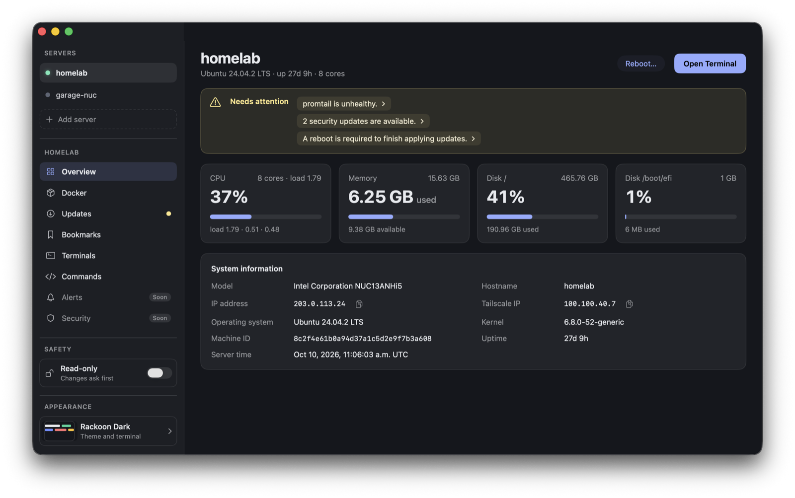
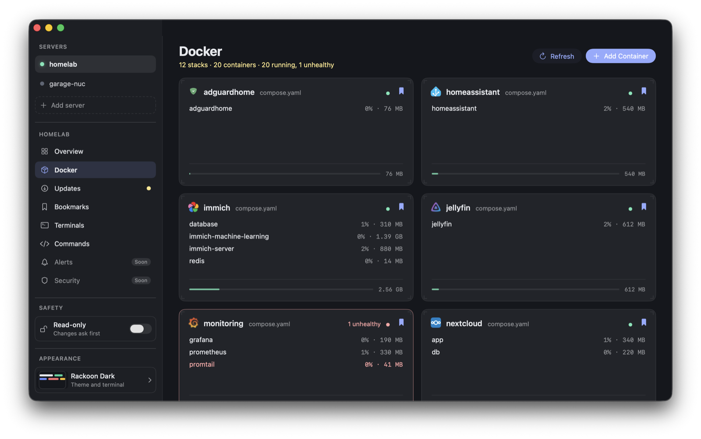
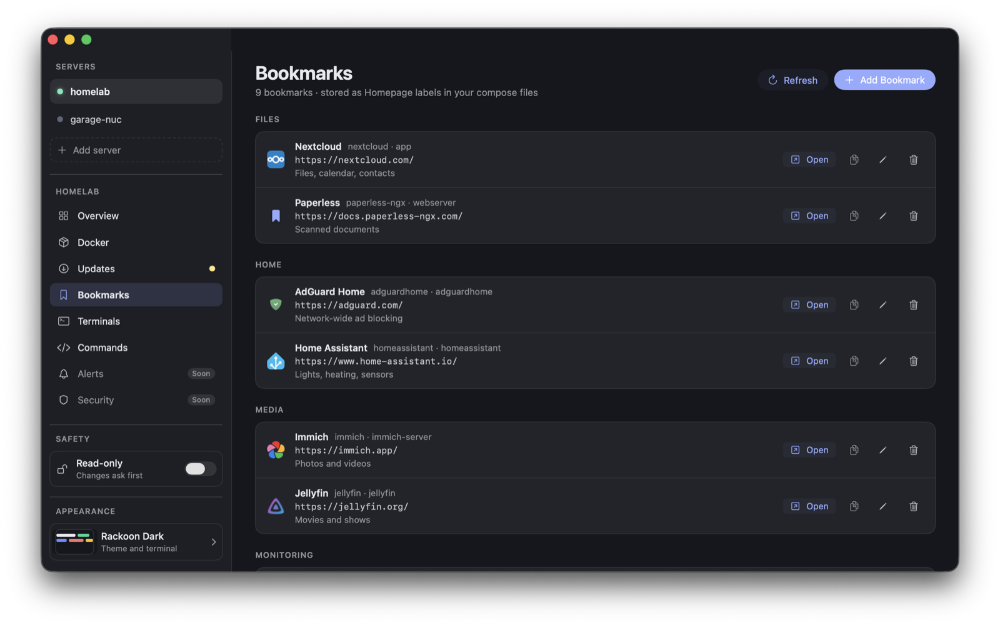
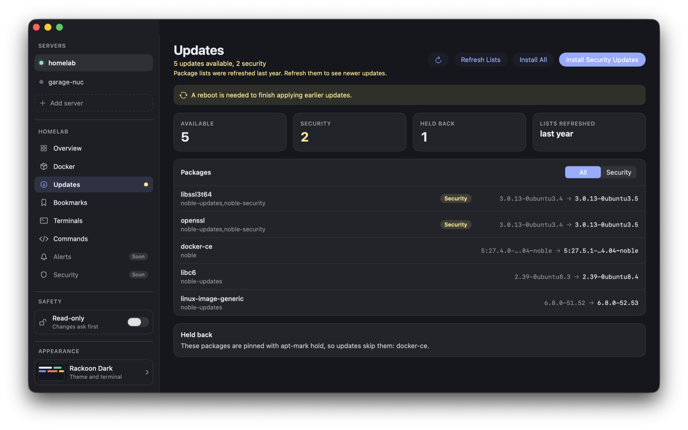
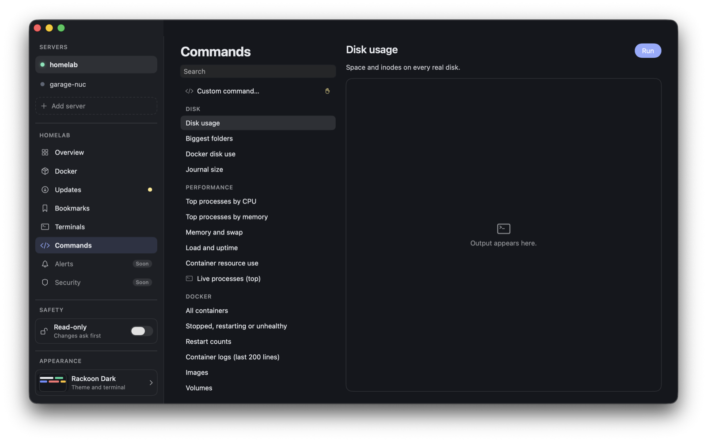
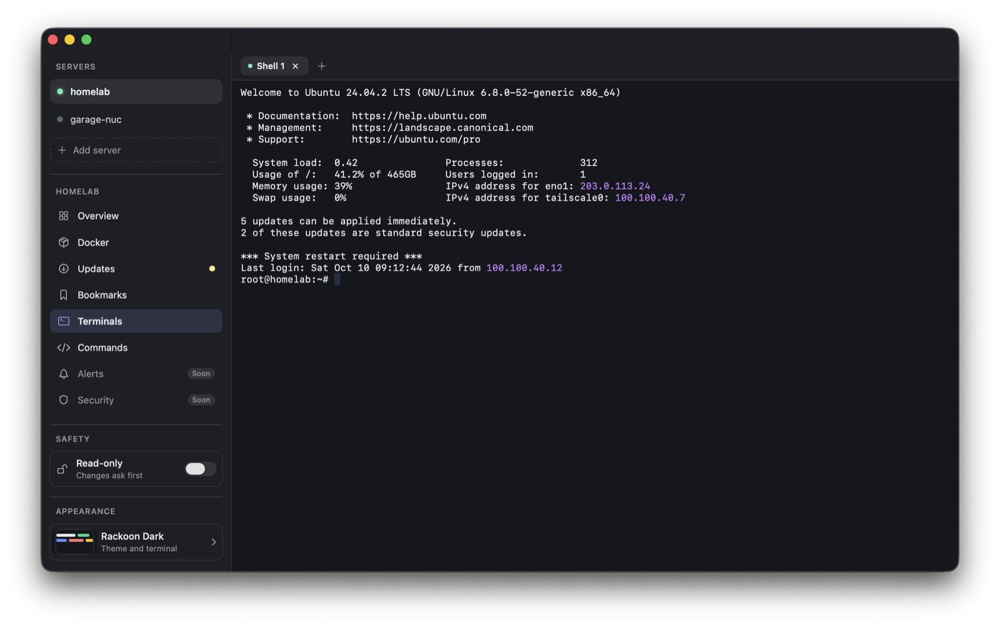

<p align="center">
  
</p>

<h1 align="center">Rackoon</h1>

<p align="center">
  An agentless SSH server manager for self-hosters: Docker Compose, Tailscale, and nothing installed on your servers.<br>
  Mac first, then iPhone and Android. Product scope and phase gates are in <a href="docs/PRD.md">docs/PRD.md</a>.
</p>

> **Status:** early and built first for the author's own servers. The Mac app works end to end against real servers; iPhone and Android are not started.

## Screenshots

<sub>Taken in demo mode, with made-up servers (see "Try it without a server" below).</sub>

| | |
|---|---|
| <a href="docs/screenshots/overview.png"></a><br>**Overview**<br>CPU, memory, disk and load at a glance, the server's identity with its IP and Tailscale IP (with copy buttons), and a "needs attention" strip for unhealthy containers, security updates and pending reboots. | <a href="docs/screenshots/docker.png"></a><br>**Docker**<br>Compose stacks as cards with per-container CPU and memory. Bookmarked stacks come first and show their site's favicon; an unhealthy stack stands out in red. Click a stack for logs, actions and the compose editor. |
| <a href="docs/screenshots/bookmarks.png"></a><br>**Bookmarks**<br>Links to your services, grouped, with favicons. They are stored as Homepage labels in each stack's compose file, so they stay with the stack. Open, copy, edit or remove from here. | <a href="docs/screenshots/updates.png"></a><br>**Updates**<br>Pending, security and held-back `apt` packages with their versions, a reboot-needed notice, and one-click Refresh Lists, Install All or Install Security Updates with live output. |
| <a href="docs/screenshots/commands.png"></a><br>**Commands**<br>A library of ready-made commands by topic (disk, performance, Docker, network, logs, security). Read-only ones run on one click; ones that change the server show a preview and ask first. | <a href="docs/screenshots/terminals.png"></a><br>**Terminals**<br>Tabs over one shared SSH connection, renameable, reconnecting on their own after a dropped link, with optional highlighting of IP addresses, errors and warnings in the output. |

## Features

**Agentless by design**
- Everything is standard SSH and shell commands on the server. No agent, no daemon, nothing to install (Debian and Ubuntu with `apt` for now; Docker is optional).
- Uses the system OpenSSH, so your `~/.ssh/config`, ssh-agent, keys and Tailscale SSH all work as they do in a terminal.
- Add a server by host, or import aliases from `~/.ssh/config`. First connections show the host key fingerprints for you to trust; a changed key is blocked, never offered for acceptance.

**Overview**
- CPU, memory, disks and load at a glance, refreshed every few seconds, with the last snapshot shown instantly while it reconnects.
- System information: model, OS, kernel, machine ID, uptime, the server's own clock, its **IP address and Tailscale IP** (only when Tailscale is up) with copy buttons.
- A "needs attention" strip: pending and security updates, reboot required, unhealthy containers, each linking to the screen that fixes it.
- Reboot with a confirmation that waits for the server to come back (it checks the boot ID, not just that SSH answers).

**Docker**
- Compose stacks as cards (containers, CPU and memory), grouped by their compose project.
- Per stack: Pull, Update, Rebuild, Restart and Recreate, with **live streamed output** and a Cancel.
- Per container: live logs (follows the end, pauses when you scroll up, jump to latest or top), Start / Stop / Restart, a shell inside the container, and Rebuild of just that service.
- A **compose.yaml and .env editor** with server-side validation (`docker compose config`), a checklist, a diff before saving, an automatic `.bak`, and a guard that refuses to overwrite a file that changed on the server. Save, or Save and Redeploy.
- **Add container**: fill in name, image, ports, volumes, environment and restart policy and watch the compose file and `.env` appear, or paste YAML and have the form fill in. Add to a new stack or an existing one. The server checks the YAML, that the image exists, that the port is free and that the name is unused.
- **Delete stack**: removes the containers and networks and, by default, the stack's folder (with safety checks), with optional volume removal and a typed-name confirmation.

**Bookmarks**
- Link to any service with a small modal, from the bookmark button on a stack card or from the Bookmarks screen. Bookmarks are stored as [Homepage](https://gethomepage.dev) Docker labels (`homepage.href`, `homepage.name`, `homepage.group`, ...) in the stack's compose file, so they stay with the stack and work with other tools that read them.
- The Bookmarks screen lists them by group, with Open, Copy, Edit and Remove.
- Each site's favicon is fetched and cached, and shown in Bookmarks and on the stack's card in the Docker overview. Click an icon to fetch a fresh one.

**Files**
- A split-pane file browser: this Mac on the left, the server on the right, with name, date, size and kind columns, breadcrumbs, back and forward, filter and sort.
- Copy by dragging between the panes or from Finder (or with the Upload and Download buttons), with a progress list and Cancel. Uploads go through the server's own shell over the existing SSH connection (no SFTP subsystem needed), are written under a temporary name and moved into place only when complete, and ask first.
- New folder, rename and delete on the server (typed confirmation for folders, system folders refused); on the Mac, deletes go to the Trash.

**Commands**
- A library of ready-made commands grouped by topic: disk, performance, Docker, network, logs, security and maintenance. Read-only ones run on one click with live output; ones that change the server (prune Docker, clear the apt cache, trim the journal, restart a service) show a dry-run preview and ask first. Some open in a terminal tab (top, follow the system log).
- A custom command box that always asks before running, with a history of this session's commands (never saved to disk, since a command can contain a password).

**Updates**
- Pending, security and held `apt` packages from the server's own package lists; refresh lists, install all or security updates only, with streamed output.

**Terminal**
- Tabs on one multiplexed SSH connection, so a new tab opens in a fraction of a second. Sessions survive switching screens and servers.
- Rename tabs, reconnect automatically after a dropped connection (with backoff and a countdown), open a shell inside any container.
- Optional output highlighting for IPs, errors, warnings, successes and high percentages, drawn from the active theme and never touching full-screen programs like vim or htop.

**Safety first**
- A **Read-only** switch that blocks every state-changing command.
- Every change shows the exact command (or a readable diff) and asks first. The check is enforced in the service layer, not just the buttons.
- Destructive choices need extra care: a typed name before deleting data, and a folder delete that refuses system folders and checks real paths.

**Looks**
- 45 themes (two of them Rackoon's own) that drive the whole app and its terminals, with Automatic following macOS light and dark.

**Keyboard**
- ⌘1–6 switch screens, ⌘[ / ⌘] switch servers (⌥⌘1–9 pick one), ⌘R refreshes the current screen (on Updates it re-reads the update list), ⇧⌘R toggles Read-only, ⌘N adds a container or bookmark, ⌘T / ⌘W open and close terminal tabs, ⇧⌘E renames a tab, ⇧⌘[ / ⇧⌘] move between tabs.

## Roadmap

- Alerts and Security (shown as "Soon" in the sidebar), and bookmark links derived automatically from Traefik host rules or published ports.
- Keychain-stored secrets and password logins (today: keys and ssh-agent).
- Editing saved servers, stacks that exist only as files, notarized builds.
- iPhone, then Android, sharing the same spec (see below).

## Install

Download `Rackoon-<version>-macos-arm64.zip` from the [Releases](https://github.com/bgallagher/rackoon/releases) page (Apple silicon, macOS 14 or later). The app is ad-hoc signed and not notarized, so the first launch needs **right-click, Open**.

To keep a stable copy installed while you work on the code, build the stable app into `/Applications` and run development builds beside it: a dev build has its own icon (the mascot behind yellow caution tape) so you can tell them apart in the Dock.

```
tools/install-app            # the stable Rackoon.app in /Applications
tools/install-app --dev      # optional: Rackoon Dev.app, with the caution-tape icon
swift run RackoonMac         # a development run also gets the caution-tape icon
```

Both read the same saved servers.

## Build from source

You need macOS with Xcode (Swift 6.2 or later, which the terminal library requires).

```
cd apple && swift run RackoonMac      # run the app
cd apple && swift test                # unit tests
python3 tools/check-spec              # validate the shared spec
tools/make-app [version]              # build build/Rackoon.app
```

Try it without a server (made-up servers, nothing is sent anywhere or saved):

```
cd apple && RACKOON_DEMO=1 swift run RackoonMac
```

Real-server checks (they only touch throwaway folders under `/tmp`):

```
cd apple && swift run rackoon-probe <host> overview
cd apple && swift run rackoon-probe <host> compose-test
cd apple && swift run rackoon-probe <host> newstack-test
```

## Layout

- `spec/` — the language-neutral contract: every shell command, model shapes, attention rules, and captured real output with the expected parse. Edit it first; platform code follows.
- `apple/` — Swift packages (`RackoonCore`, `RackoonSSHSystem`) and the Mac app.
- `android/` — reserved for the Kotlin core and Compose app.
- `tools/` — spec validation, fixture capture, app bundling, theme import.
- `docs/` — the PRD and notes. `CLAUDE.md` describes the architecture in detail.

The server logic is small, so it is written twice (Swift now, Kotlin later) and kept in step by the shared `spec/` and its golden fixtures.

## Licence

Not yet chosen. The bundled terminal themes come from the MIT-licensed [iTerm2-Color-Schemes](https://github.com/mbadolato/iTerm2-Color-Schemes) collection (see `apple/Apps/RackoonMac/Resources/SOURCES.md`).
